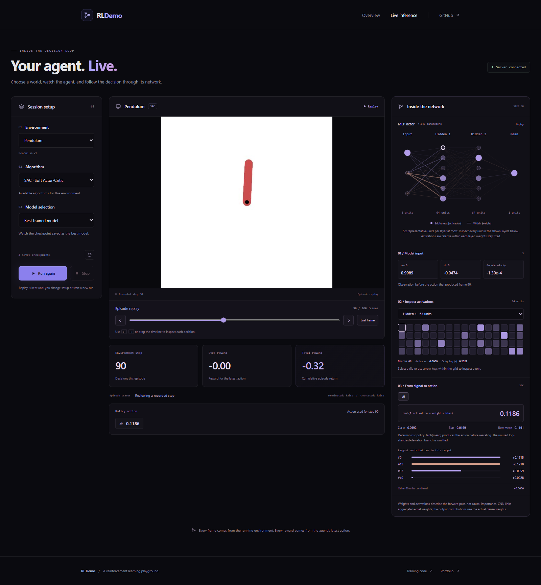

# RLDemo

**Watch reinforcement learning agents play, replay their decisions, and explore their neural networks.**

RLDemo is a local web application for running trained PyTorch agents in Gymnasium environments. A Python API runs each episode and streams the game frames, actions, rewards, and network activity to a React interface in real time.



[Features](#features) · [Installation](#installation) · [Run locally](#run-locally) · [Tutorials](#things-i-learned-during-this-project) · [License](#license)

## Features

- **Demo gallery** with animated gameplay previews for four environments.
- **Live inference** with environment, algorithm, and checkpoint selection, plus a random-action baseline.
- **Episode replay** to review frames, actions, and rewards with a timeline and keyboard controls.
- **Neural-network inspection** showing model inputs, hidden activations, weights, and the final action calculation, synchronized with live inference and replay.
- **One development command** to start both the API and frontend with Concurrently.

### Environments and models

| Environment | Algorithm | Checkpoints included |
| --- | --- | --- |
| CartPole-v1 | DQN (Deep Q-Network) | Yes |
| Pendulum-v1 | SAC (Soft Actor-Critic) | Yes |
| BipedalWalker-v3 | SAC | Yes |
| CarRacing-v3 | SAC | No; random actions available |

Checkpoints are discovered in `models/<environment>/<algorithm>/*.pt`. Depending on the files available, you can select the best model, worst model, a random saved model, or a specific checkpoint. Random actions work without a checkpoint.

This repository runs inference with existing models. See [checkpoint compatibility](docs/live_inference.md#checkpoint-compatibility) before adding your own exports, then refresh the model list in the interface.

## How it works

1. The **React + TypeScript frontend**, served by Vite during development, lets you configure and view an episode.
2. The **FastAPI server** exposes environment and model discovery over HTTP and streams episodes over a WebSocket.
3. The **inference runner** loads a PyTorch policy, steps the Gymnasium environment, and records network activity. OpenCV encodes the rendered frames as JPEGs.

Vite forwards `/api` requests and WebSocket connections to the Python server on port `8000`. No environment file is needed for the default local setup.

## Prerequisites

The quick start below uses **Windows PowerShell**, matching the current root npm scripts.

| Dependency | Requirement |
| --- | --- |
| Git | To clone the repository. |
| Node.js + npm | **Node.js 24**, used by the current setup, or Node.js 22 (22.13 or newer). |
| Python | **3.13** is used by the working local environment. |

Python dependencies are listed in [requirements.txt](requirements.txt): FastAPI, Uvicorn with WebSocket and reload support, PyTorch, Gymnasium with classic-control and Box2D extras, NumPy, OpenCV, Pydantic, and websockets. The Gymnasium extras install the rendering and physics dependencies for the four environments.

JavaScript dependencies are declared separately in the root [package.json](package.json) (Concurrently) and [frontend/package.json](frontend/package.json) (React, Vite, TypeScript, and development tools).

Inference can run on CPU. The runner uses CUDA automatically when a compatible PyTorch installation and GPU are available.

## Installation

Run these commands from PowerShell.

### 1. Clone the repository

```powershell
git clone https://github.com/victrolles/RLDemo.git
cd RLDemo
```

### 2. Create the Python environment

Make sure `python --version` reports Python 3.13, then create `.venv` at the repository root:

```powershell
python -m venv .venv
.\.venv\Scripts\python.exe -m pip install --upgrade pip
.\.venv\Scripts\python.exe -m pip install -r requirements.txt
```

The npm scripts call this environment's Python executable directly, so activating the environment is optional.

### 3. Install JavaScript dependencies

Install both the root orchestrator and the frontend dependencies:

```powershell
npm ci
npm ci --prefix frontend
```

`npm ci` installs the versions recorded in each lockfile. You can use `npm install` and `npm install --prefix frontend` instead when intentionally updating dependencies.

## Run locally

From the repository root:

```powershell
npm run dev
```

Concurrently starts **FastAPI with automatic reload** and the **Vite development server** in one terminal, with separate `API` and `WEB` log labels. Press **Ctrl+C** to stop them; if either process exits, the other is stopped too.

| Service | Default URL |
| --- | --- |
| Frontend | http://localhost:5173 |
| Live inference | http://localhost:5173/#/inference/ |
| API health | http://127.0.0.1:8000/health |
| Interactive API documentation | http://127.0.0.1:8000/docs |

Use the frontend URL printed by Vite if port `5173` is already occupied. Open **Live inference**, select an environment and model, then start an episode. After it finishes or you stop it, use the replay timeline to inspect individual steps.

**The current launch command is `npm run dev`.** There is no `npm start` script in this version.

### Available commands

Run these from the repository root:

| Command | Purpose |
| --- | --- |
| `npm run dev` | Start the API and frontend together. |
| `npm run dev:api` | Start only the API, using `.venv` (Windows). |
| `npm run dev:web` | Start only the frontend. |
| `npm run build` | Type-check and build the frontend into `frontend/dist/`. |
| `npm run lint` | Run the frontend ESLint checks. |
| `npm run test:api` | Run the Python unittest suite, using `.venv` (Windows). |

### macOS and Linux

The root `dev:api` and `test:api` scripts currently use Windows executable paths. On macOS or Linux, create the environment with `python3.13 -m venv .venv`, install dependencies with `.venv/bin/python -m pip install -r requirements.txt`, and run the same two npm installation commands above.

Start the API and frontend in separate terminals from the repository root:

```sh
# Terminal 1
.venv/bin/python -m uvicorn server.app:app --reload --host 127.0.0.1 --port 8000
```

```sh
# Terminal 2
npm run dev:web
```

To run the Python tests on these systems, use `.venv/bin/python -m unittest discover -s tests -v`.

## Configuration and current limits

- **API connection:** the development proxy targets `http://127.0.0.1:8000` by default. Set `RL_API_TARGET` before launching Vite to change it. For a direct API connection, see [frontend/.env.example](frontend/.env.example) and [frontend setup](frontend/README.md#live-inference).
- **Separate origins:** configure `RL_CORS_ORIGINS` on the API when serving the frontend from another origin.
- **Sessions:** the API runs one inference session at a time. Episodes are limited to 3,000 steps.
- **Replay:** episode history stays in browser memory and is cleared when starting another run, changing setup, or leaving or refreshing the page.
- **Deployment:** `npm run build` builds the frontend only. Serve the API separately and configure HTTP and WebSocket routing; see [frontend deployment notes](frontend/README.md#live-inference).

## Things I learned during this project

Tutorials and implementation notes collected while building RLDemo:

| Guide | Topics |
| --- | --- |
| [Create a React frontend](docs/tutorials/create_react_frontend.md) | Set up Node.js, npm, React, TypeScript, Vite, and routing. |
| [Orchestrate a local project with Concurrently](docs/tutorials/local_orchestrator.md) | Start the API and frontend together and manage their lifecycle through npm scripts. |
| [Build a live inference API](docs/live_inference.md) | Discover checkpoints, stream frames over WebSockets, replay episodes, and inspect neural networks. |
| [Frontend implementation notes](frontend/README.md) | Configure the API proxy, add gameplay GIFs, and understand the viewer and replay interface. |

## Project structure

```text
RLDemo/
├── agents/           # PyTorch network definitions and inference policies
├── inference/        # Environments, model loading, runner, and network inspection
├── server/           # FastAPI endpoints and WebSocket sessions
├── frontend/         # React + TypeScript interface
├── models/           # Saved checkpoints grouped by environment and algorithm
├── tests/            # Python tests and manual inference examples
├── docs/             # Technical documentation, tutorials, and screenshots
├── package.json      # Local orchestration and shared development commands
└── requirements.txt  # Python dependencies
```

## License

Released under the [MIT License](LICENSE). Copyright © 2026 Victor Goudal.
